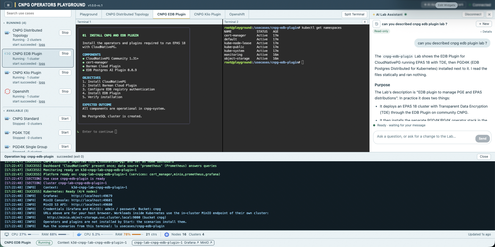

[](https://shields.io/)
[](https://GitHub.com/Naereen/StrapDown.js/graphs/commit-activity)

# CNPG Operator Playground

A local playground to try operators and architecture on Kubernetes ([CloudNativePG](https://cloudnative-pg.io/), EDB products, competition, ...). One container holds the tooling and creates K8s clusters; a Web UI gives each use case guided, interactive scenarios in a terminal.



## Install

Prerequisites: Docker with Compose v2 (about 8 GB of memory for Docker) and Git. Nothing else is needed on your machine.

```bash
git clone <repository-url>
cd cnpg-operator-playground
./00-provision.sh
```

`00-provision.sh` checks the prerequisites, builds the image and starts the Playground. When it ends, open <http://127.0.0.1:8080>.

EDB products need a subscription token: `cp .env.example .env` and set `EDB_SUBSCRIPTION_TOKEN`.

## Try a first scenario

1. In the Web UI, select **cnpg-standard** and click **Start** (the first start takes several minutes).
2. Open its terminal tab: it starts in the use case directory.
3. Run `./01_install_operators.sh` and press Enter to move through each step.

The next scenarios (`02_…`, `03_…`) are in the same directory, in order.

**Starting a use case can be cancelled:** while it is starting, its button becomes **Cancel**; it ends the start and runs the normal Stop (the use case's own clusters are deleted, an external cluster is only detached). `./playground doctor` also checks host resources (disk, inodes, memory, inotify, open files) and prints manual corrections; the same checks feed the Disk figure and the warning marker of the resource bar, and the warnings of a use case start. Nothing is ever changed on your machine for you.

## Clean up

```bash
./99-deprovision.sh
```

Deletes the Playground's Kind clusters, volumes, container and image, after a confirmation (only resources it owns). Preview with `./99-deprovision.sh --dry-run`.

## More

Both scripts wrap the `./playground` command line (`./playground help`). See also [CONTRIBUTING.md](CONTRIBUTING.md).
